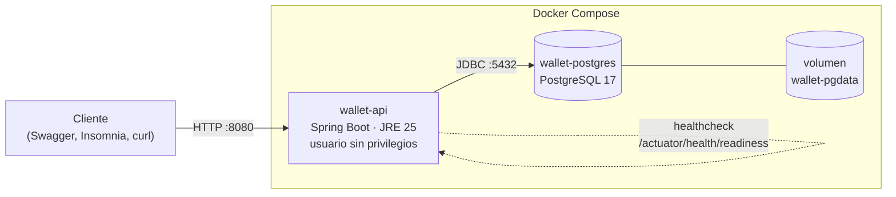
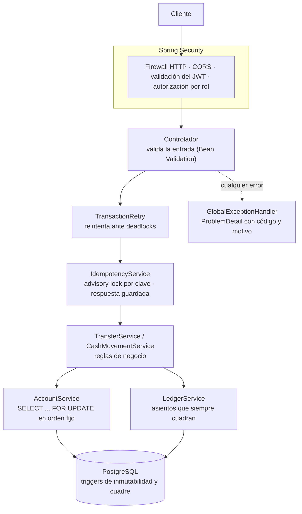
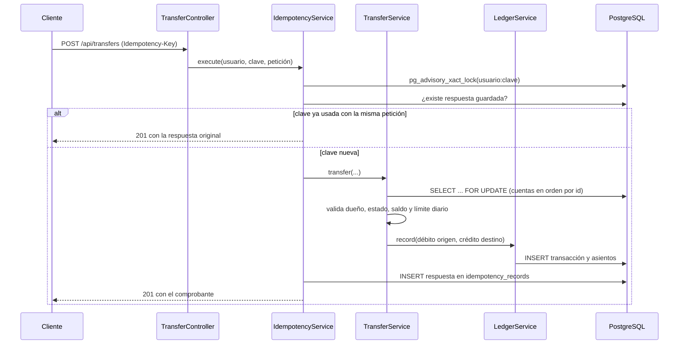
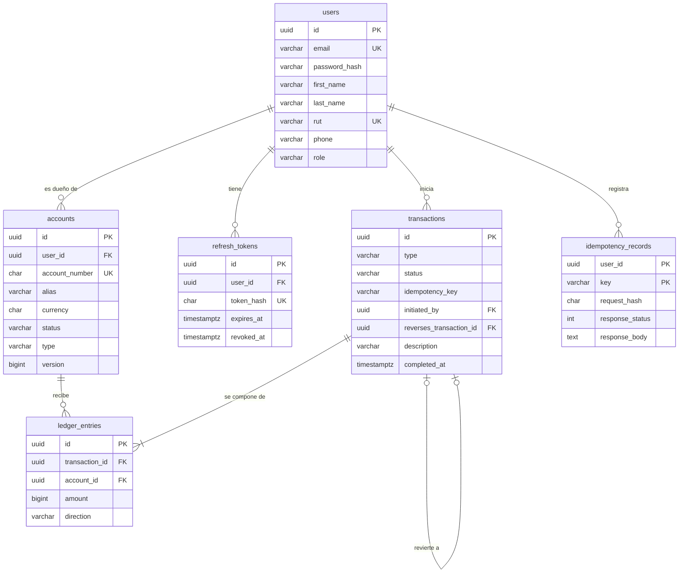
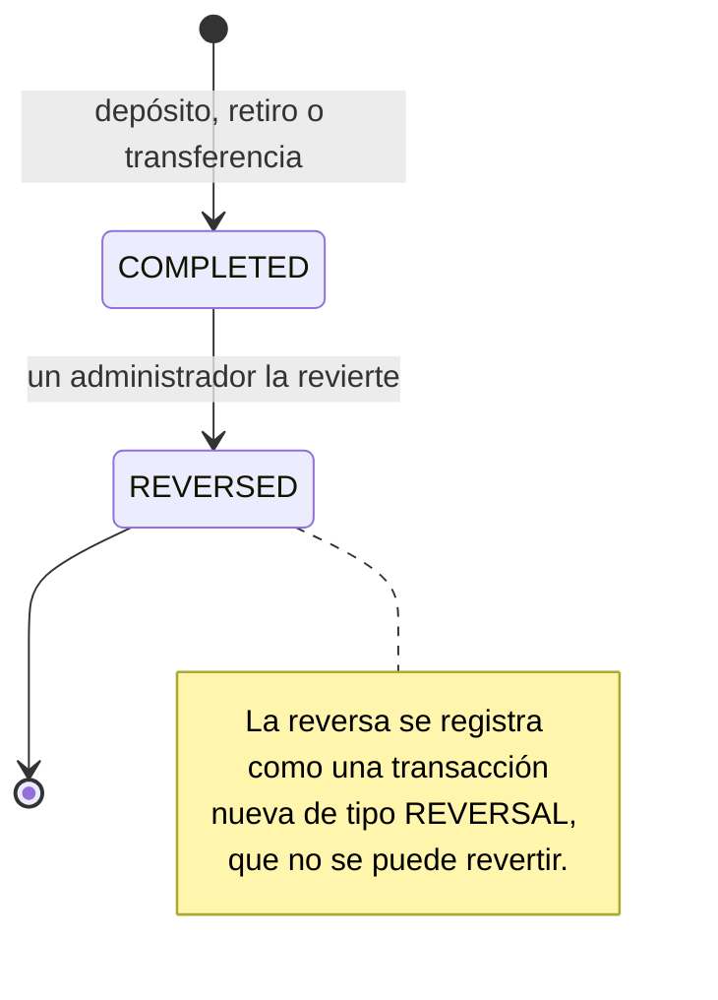

# Wallet API

[](https://github.com/ExOBrienX/wallet-api/actions/workflows/ci.yml)
[](https://github.com/ExOBrienX/wallet-api/actions/workflows/codeql.yml)


[](LICENSE)

API REST de una billetera digital construida con Java 25 y Spring Boot 4. Los clientes abren
cuentas en pesos chilenos, depositan, retiran y se transfieren dinero simulado. Todo movimiento
queda registrado en un libro contable de doble entrada, de modo que el saldo de cualquier cuenta
se puede reconstruir y verificar en todo momento.

El foco del proyecto no es la cantidad de funcionalidades sino la corrección: que el dinero nunca
se cree ni se pierda, aunque lleguen cientos de operaciones simultáneas, un cliente repita una
petición o algo falle a mitad de una transferencia.

## Contenido

- [Tecnologías](#tecnologías)
- [Ejecutar el proyecto](#ejecutar-el-proyecto)
- [Guía de uso](#guía-de-uso)
- [Arquitectura](#arquitectura)
- [Modelo de datos](#modelo-de-datos)
- [Endpoints](#endpoints)
- [Errores](#errores)
- [Reglas de negocio](#reglas-de-negocio)
- [Seguridad](#seguridad)
- [Salud del servicio](#salud-del-servicio)
- [Decisiones técnicas](#decisiones-técnicas)
- [Pruebas](#pruebas)
- [Integración continua](#integración-continua)
- [Posibles mejoras](#posibles-mejoras)

## Tecnologías

| Área | Tecnología | Versión |
|---|---|---|
| Lenguaje | Java (Eclipse Temurin) | 25 LTS |
| Framework | Spring Boot | 4.1.2 |
| Web | Spring MVC sobre Tomcat | 7.0 / 11.0 |
| Seguridad | Spring Security, OAuth2 Resource Server (JWT con Nimbus) | 7.1 |
| Persistencia | Spring Data JPA, Hibernate | 7.4 |
| Base de datos | PostgreSQL | 17 |
| Migraciones | Flyway | 12.4 |
| Validación | Jakarta Bean Validation (Hibernate Validator) | 9 |
| JSON | Jackson | 3.1 |
| Documentación | springdoc-openapi (Swagger UI) | 3.2 |
| Observabilidad | Spring Boot Actuator | 4.1 |
| Pruebas | JUnit, Mockito, AssertJ, Testcontainers | 6.0 / 5.23 / 3.27 / 2.0 |
| Build | Maven (wrapper incluido) | 3.10 |
| Contenedores | Docker, Docker Compose | |
| Integración continua | GitHub Actions, CodeQL, Dependabot | |

Lombok se usa solo en las entidades JPA. No hay otras dependencias: los reintentos usan el
`RetryTemplate` incluido en Spring Framework 7 y el límite de intentos de login está
implementado sin librerías externas.

## Ejecutar el proyecto

Solo se necesita Docker. Desde la raíz del repositorio:

```bash
docker compose up --build
```

Eso levanta PostgreSQL y la API en `http://localhost:8080`. La documentación interactiva queda en
[`http://localhost:8080/swagger-ui.html`](http://localhost:8080/swagger-ui.html).



Al arrancar se cargan cuatro clientes de demostración con cuentas, depósitos, retiros y
transferencias entre ellos. Todos usan la contraseña `demo12345`:

| Cliente | Correo |
|---|---|
| Camila Rojas | `camila.rojas@demo.cl` |
| Matías González | `matias.gonzalez@demo.cl` |
| Valentina Muñoz | `valentina.munoz@demo.cl` |
| Benjamín Soto | `benjamin.soto@demo.cl` |

### Configuración opcional

Los valores por defecto sirven para uso local. Para cambiarlos se copia `.env.example` a `.env`:

| Variable | Uso |
|---|---|
| `JWT_SECRET` | Clave para firmar los tokens (mínimo 32 caracteres). Si no se define, el contenedor genera una aleatoria en cada arranque y las sesiones no sobreviven a un reinicio |
| `WALLET_ADMIN_EMAIL`, `WALLET_ADMIN_PASSWORD` | Crean un administrador al arrancar, necesario para `/api/admin` |
| `CORS_ALLOWED_ORIGINS` | Dominios que pueden llamar a la API desde un navegador, separados por coma. Vacío por defecto |
| `API_DOCS_ENABLED` | `false` desactiva Swagger UI y la especificación OpenAPI |
| `DB_NAME`, `DB_USERNAME`, `DB_PASSWORD`, `DB_PORT` | Conexión a PostgreSQL |

### Desarrollo local

Con Java 25 instalado se puede levantar solo la base de datos y ejecutar la API desde el IDE o
con Maven:

```bash
docker compose up -d postgres
./mvnw spring-boot:run
```

```bash
./mvnw test     # tests unitarios
./mvnw verify   # unitarios e integración (requiere Docker)
```

## Guía de uso

La API se puede probar de tres formas:

- **Swagger UI** en `/swagger-ui.html`: documentación interactiva con ejemplos y los errores
  posibles de cada endpoint.
- **Insomnia**: importar [`docs/insomnia/wallet-api.insomnia.json`](docs/insomnia/wallet-api.insomnia.json)
  y elegir el entorno *Local*. Las peticiones toman el token del login, el id de la cuenta y el
  número de destino de forma automática, y generan una `Idempotency-Key` nueva en cada envío.
- **curl**, siguiendo el recorrido de abajo.

### Recorrido completo con curl

Los ejemplos están escritos para bash y usan [jq](https://jqlang.org/) para extraer valores de
las respuestas JSON, y `uuidgen` para generar las claves de idempotencia. En Windows se pueden
ejecutar desde WSL, o instalar jq y reemplazar `uuidgen` por cualquier UUID (en PowerShell,
`[guid]::NewGuid()`).

Primero se inicia sesión con un cliente de demostración y se guarda el token de acceso:

```bash
API=http://localhost:8080
TOKEN=$(curl -s -X POST $API/api/auth/login -H 'Content-Type: application/json' \
  -d '{"email": "camila.rojas@demo.cl", "password": "demo12345"}' | jq -r .accessToken)
```

Se listan sus cuentas con el saldo de cada una, y se guardan la primera cuenta como origen y el
número de la segunda como destino:

```bash
curl -s $API/api/accounts -H "Authorization: Bearer $TOKEN" | jq
ORIGEN=$(curl -s $API/api/accounts -H "Authorization: Bearer $TOKEN" | jq -r '.[0].id')
DESTINO=$(curl -s $API/api/accounts -H "Authorization: Bearer $TOKEN" | jq -r '.[1].accountNumber')
```

Un depósito. Toda operación que mueve dinero lleva una `Idempotency-Key` única, generada por el
cliente:

```bash
curl -s -X POST $API/api/deposits -H "Authorization: Bearer $TOKEN" \
  -H 'Content-Type: application/json' -H "Idempotency-Key: $(uuidgen)" \
  -d "{\"accountId\": \"$ORIGEN\", \"amount\": 150000, \"description\": \"Sueldo\"}" | jq
```

Una transferencia enviada dos veces con la misma clave. La segunda respuesta es idéntica a la
primera, trae el header `Idempotent-Replayed: true` y no mueve dinero otra vez:

```bash
CLAVE=$(uuidgen)
for intento in 1 2; do
  curl -s -i -X POST $API/api/transfers -H "Authorization: Bearer $TOKEN" \
    -H 'Content-Type: application/json' -H "Idempotency-Key: $CLAVE" \
    -d "{\"sourceAccountId\": \"$ORIGEN\", \"destinationAccountNumber\": \"$DESTINO\", \"amount\": 45000}" \
    | grep -E 'HTTP/|Idempotent-Replayed'
done
```

Un retiro mayor que el saldo, que se rechaza con un error en formato `ProblemDetail`:

```bash
curl -s -X POST $API/api/withdrawals -H "Authorization: Bearer $TOKEN" \
  -H 'Content-Type: application/json' -H "Idempotency-Key: $(uuidgen)" \
  -d "{\"accountId\": \"$ORIGEN\", \"amount\": 99999999}" | jq
```

Y el historial de la cuenta, del movimiento más reciente al más antiguo:

```bash
curl -s "$API/api/accounts/$ORIGEN/transactions?page=0&size=10" -H "Authorization: Bearer $TOKEN" | jq
```

Para las operaciones de administración se necesita un administrador, definido con
`WALLET_ADMIN_EMAIL` y `WALLET_ADMIN_PASSWORD` en el `.env`. Con su token se puede, por ejemplo,
conciliar el libro:

```bash
ADMIN=$(curl -s -X POST $API/api/auth/login -H 'Content-Type: application/json' \
  -d "{\"email\": \"$WALLET_ADMIN_EMAIL\", \"password\": \"$WALLET_ADMIN_PASSWORD\"}" | jq -r .accessToken)
curl -s $API/api/admin/reconciliation -H "Authorization: Bearer $ADMIN" | jq
```

## Arquitectura

El código se organiza por funcionalidad y no por capa técnica: cada paquete contiene sus
controladores, servicios, repositorios, entidades y DTOs.

```
cl.exobrienx.wallet
├── auth/        registro, login, refresh tokens, emisión de JWT y límite de intentos
├── user/        usuarios y administrador inicial
├── account/     cuentas, saldo, historial y bloqueo ordenado de cuentas
├── ledger/      libro contable: transacciones, asientos, conciliación e indicador de salud
├── transfer/    depósitos, retiros, transferencias e idempotencia
├── admin/       bloqueo de cuentas y reversas
└── common/      seguridad, errores, validaciones, reintentos, configuración y datos de demo
```

Una petición que mueve dinero atraviesa estas capas. Cada una tiene una sola responsabilidad, y
el libro contable es el único componente que escribe asientos:



El recorrido de una transferencia muestra cómo encajan las piezas:



## Modelo de datos

El esquema se crea y versiona con Flyway. Hibernate solo valida que las entidades coincidan con
él (`ddl-auto: validate`). La descripción completa de cada tabla, sus restricciones, índices y
triggers, con ejemplos de cómo se registra cada operación, está en
[`docs/base-de-datos.md`](docs/base-de-datos.md).



La tabla `accounts` no tiene columna de saldo. El saldo de una cuenta es la suma de sus créditos
menos la suma de sus débitos en `ledger_entries`. Depósitos y retiros usan como contraparte una
cuenta interna del sistema, para que también queden en doble entrada.

Una transacción se registra ya completada, en una sola transacción de base de datos. Lo único
que puede cambiar después es su estado, cuando un administrador la revierte; la reversa es una
transacción nueva con los asientos inversos:



Los estados `PENDING` y `FAILED` están reservados en el esquema para operaciones asíncronas, que
esta versión no tiene.

## Endpoints

| Método | Ruta | Acceso | Descripción |
|---|---|---|---|
| POST | `/api/auth/register` | Público | Registra un cliente |
| POST | `/api/auth/login` | Público | Entrega token de acceso y refresh token |
| POST | `/api/auth/refresh` | Público | Renueva los tokens y rota el refresh token |
| POST | `/api/auth/logout` | Cliente | Revoca el refresh token |
| POST | `/api/accounts` | Cliente | Abre una cuenta |
| GET | `/api/accounts` | Cliente | Lista las cuentas propias con su saldo |
| GET | `/api/accounts/{id}` | Dueño o admin | Detalle y saldo de una cuenta |
| GET | `/api/accounts/{id}/transactions` | Dueño o admin | Historial paginado, filtrable por fechas |
| POST | `/api/deposits` | Cliente | Depósito simulado (requiere `Idempotency-Key`) |
| POST | `/api/withdrawals` | Cliente | Retiro simulado (requiere `Idempotency-Key`) |
| POST | `/api/transfers` | Cliente | Transferencia a un número de cuenta (requiere `Idempotency-Key`) |
| PATCH | `/api/admin/accounts/{id}/status` | Admin | Bloquea o reactiva una cuenta |
| POST | `/api/admin/transactions/{id}/reverse` | Admin | Revierte una transacción |
| GET | `/api/admin/reconciliation` | Admin | Concilia el libro contable |

## Errores

Todas las respuestas de error siguen el formato `ProblemDetail` (RFC 9457) e incluyen un
código estable, para que un cliente decida qué hacer sin depender del texto, y el motivo en
español. Nunca repiten el valor recibido ni exponen detalles internos.

```json
{
  "type": "about:blank",
  "title": "Saldo insuficiente",
  "status": 422,
  "code": "INSUFFICIENT_FUNDS",
  "detail": "La cuenta no tiene saldo suficiente para esta operación.",
  "instance": "/api/transfers"
}
```

Los errores de validación agregan el detalle de cada campo:

```json
{
  "title": "Datos inválidos",
  "status": 400,
  "code": "VALIDATION_ERROR",
  "detail": "La petición tiene campos inválidos. El detalle de cada uno está en 'errors'.",
  "errors": {
    "amount": ["debe ser mayor que 0"],
    "rut": ["no es un RUT válido"]
  }
}
```

| HTTP | Código | Cuándo ocurre |
|---|---|---|
| 400 | `VALIDATION_ERROR` | Uno o más campos no cumplen las reglas; el detalle viene en `errors` |
| 400 | `MALFORMED_BODY` | El cuerpo está vacío, no es JSON o un campo tiene un tipo incorrecto (se indica cuál) |
| 400 | `MISSING_HEADER` | Falta un header obligatorio, como `Idempotency-Key` |
| 400 | `MISSING_PARAMETER` | Falta un parámetro obligatorio |
| 400 | `INVALID_PARAMETER` | Un parámetro de la ruta o de la consulta tiene formato inválido (se indica el esperado) |
| 400 | `INVALID_ACCOUNT_NUMBER` | El número de cuenta de destino no pasa el dígito verificador |
| 400 | `INVALID_DATE_RANGE` | `from` es posterior a `to` en el historial |
| 400 | `PAGE_OUT_OF_RANGE` | Se pidió una página más allá del límite recorrible del historial |
| 400 | `REQUEST_REJECTED` | La URL contiene secuencias no permitidas (rechazada por el firewall) |
| 401 | `AUTHENTICATION_REQUIRED` | La petición no trae token de acceso |
| 401 | `INVALID_TOKEN` | El token no es válido, fue alterado o expiró |
| 401 | `INVALID_CREDENTIALS` | Correo o contraseña incorrectos (mismo mensaje en ambos casos) |
| 401 | `INVALID_REFRESH_TOKEN` | El refresh token no existe, expiró o fue revocado |
| 403 | `ACCESS_DENIED` | El rol del usuario no permite la operación |
| 404 | `ACCOUNT_NOT_FOUND` | La cuenta no existe o no pertenece al usuario |
| 404 | `DESTINATION_ACCOUNT_NOT_FOUND` | No existe una cuenta con el número de destino |
| 404 | `TRANSACTION_NOT_FOUND` | La transacción a revertir no existe |
| 404 | `NOT_FOUND` | La ruta no existe |
| 405 | `METHOD_NOT_ALLOWED` | El método HTTP no corresponde a la ruta (se indican los permitidos) |
| 406 | `NOT_ACCEPTABLE` | Se pidió una respuesta en un formato distinto de JSON |
| 409 | `EMAIL_ALREADY_REGISTERED` | Ya existe un usuario con ese correo |
| 409 | `RUT_ALREADY_REGISTERED` | Ya existe un usuario con ese RUT |
| 409 | `CONCURRENT_MODIFICATION` | Otro administrador modificó la misma cuenta al mismo tiempo |
| 409 | `DUPLICATE_IDEMPOTENCY_KEY` | Protección interna; en el uso normal se devuelve la respuesta guardada |
| 415 | `UNSUPPORTED_MEDIA_TYPE` | El cuerpo no se envió como `application/json` |
| 422 | `INSUFFICIENT_FUNDS` | El saldo no alcanza para el retiro o la transferencia |
| 422 | `DAILY_TRANSFER_LIMIT_EXCEEDED` | La transferencia supera el límite diario (se indica cuánto queda) |
| 422 | `SAME_ACCOUNT_TRANSFER` | Origen y destino son la misma cuenta |
| 422 | `ACCOUNT_BLOCKED` | La cuenta de origen está bloqueada |
| 422 | `DESTINATION_ACCOUNT_UNAVAILABLE` | La cuenta de destino está bloqueada |
| 422 | `ACCOUNT_LIMIT_REACHED` | El cliente ya tiene el máximo de cuentas |
| 422 | `IDEMPOTENCY_KEY_REUSED` | La `Idempotency-Key` ya se usó con otra petición |
| 422 | `TRANSACTION_NOT_REVERSIBLE` | La transacción ya fue revertida o es una reversa |
| 422 | `SYSTEM_ACCOUNT_MODIFICATION` | Se intentó bloquear la cuenta interna del sistema |
| 429 | `TOO_MANY_LOGIN_ATTEMPTS` | Demasiados intentos fallidos de login; `Retry-After` indica cuándo reintentar |
| 500 | `INTERNAL_ERROR` | Error inesperado; se registra en el log sin exponer detalles |
| 503 | `SERVICE_BUSY` | Conflicto de concurrencia persistente; se puede reintentar con la misma `Idempotency-Key` |

## Reglas de negocio

1. Cada transacción genera asientos cuyos débitos suman lo mismo que sus créditos.
2. El saldo se calcula desde los asientos; nunca se guarda ni se edita.
3. Asientos y transacciones son inmutables. Lo único que cambia es el estado de una transacción
   cuando se revierte.
4. Ningún retiro ni transferencia puede dejar una cuenta en negativo.
5. Cada cuenta puede transferir hasta $1.000.000 por día calendario en hora de Chile
   (configurable).
6. No se puede transferir a la misma cuenta, ni desde o hacia una cuenta bloqueada.
7. Los montos son pesos enteros (`long`). Un monto con decimales se rechaza.
8. Un cliente solo ve y opera sus propias cuentas; un administrador puede consultar todas.
9. Una reversa crea una transacción nueva con los asientos inversos. Cada transacción se revierte
   una sola vez y una reversa no se revierte. Puede dejar una cuenta en negativo, como un
   contracargo: esa cuenta no puede enviar dinero hasta recuperar saldo, pero sí recibirlo.

## Seguridad

| Aspecto | Cómo se resuelve |
|---|---|
| Autenticación | JWT HS256 de 15 minutos, con algoritmo, emisor y expiración validados. Se rechazan tokens sin firma o firmados con otra clave |
| Sesiones | Refresh token aleatorio de 256 bits, guardado como hash y rotado en cada uso; reutilizar uno revocado cierra todas las sesiones del usuario |
| Contraseñas | BCrypt, con validación del límite de 72 bytes del algoritmo |
| Fuerza bruta | Tras 5 intentos fallidos en 15 minutos para un correo desde una IP, el login responde 429 con `Retry-After` |
| Enumeración | El login responde igual y tarda lo mismo exista o no el correo; las cuentas ajenas responden 404 |
| Autorización | Roles USER y ADMIN; cada cliente solo accede a sus cuentas |
| Inyección SQL | Todas las consultas usan parámetros; ninguna concatena texto |
| Entrada | Validación de cada campo. Los textos libres rechazan caracteres de control e inversores de dirección; los nombres solo admiten letras y separadores; los montos son enteros con un máximo |
| CORS | Cerrado por defecto: ningún sitio puede llamar a la API desde un navegador salvo los dominios configurados |
| URLs sospechosas | El firewall de Spring Security y Tomcat rechazan secuencias como `..;/`, `%2e%2e` o `%5C`; incluso esos rechazos responden en formato ProblemDetail, sin páginas HTML ni datos del servidor |
| Errores | Formato `ProblemDetail` con código y motivo, sin trazas ni valores recibidos |
| Headers | `X-Content-Type-Options`, `X-Frame-Options`, `Cache-Control` y `Referrer-Policy` |
| Secretos | Ningún secreto en el repositorio; el JWT se firma con una variable de entorno |
| Contenedor | El proceso corre con un usuario sin privilegios |
| Dependencias y código | Dependabot vigila vulnerabilidades en las dependencias; CodeQL analiza el código en cada push |

Algunas decisiones conscientes: el registro informa si un correo o RUT ya existe, porque en una
billetera el usuario necesita saberlo para recuperar su acceso; el límite de intentos de login
se guarda en memoria, lo que basta para una instancia (con varias habría que compartirlo, por
ejemplo en Redis); un token de acceso robado sigue siendo válido hasta que expira, como máximo
quince minutos, porque revocarlo antes exigiría consultar la base de datos en cada petición; y la
documentación OpenAPI es pública, pero se puede desactivar con `API_DOCS_ENABLED=false`. La API
no termina TLS ni limita el volumen de peticiones fuera del login: en un despliegue real va
detrás de un proxy o gateway que lo haga.

## Salud del servicio

| Endpoint | Para qué |
|---|---|
| `/actuator/health` | Estado general. El detalle por componente solo lo ve un administrador |
| `/actuator/health/liveness` | El proceso está vivo. Si falla, el orquestador reinicia el contenedor |
| `/actuator/health/readiness` | La instancia puede recibir tráfico: base de datos y libro contable disponibles |
| `/actuator/info` | Nombre y descripción de la aplicación |

Readiness incluye un indicador propio del libro contable, que verifica que exista la cuenta
interna del sistema y que estén instalados los triggers que protegen el libro. La imagen Docker
declara un healthcheck sobre ese endpoint, por lo que `docker compose ps` muestra si la API está
realmente lista. Si la base de datos se cae, readiness pasa a DOWN (503) mientras liveness sigue
en UP, para que el contenedor no se reinicie sin necesidad; al volver la base, todo se recupera
solo.

## Decisiones técnicas

**Saldo calculado y doble entrada.** Guardar el saldo en una columna obliga a mantenerlo
sincronizado con los movimientos, y cualquier error lo deja inconsistente sin dejar rastro.
Calculándolo desde los asientos, el historial es la única fuente de verdad y la conciliación
puede verificar en cualquier momento que el dinero total no cambió. El costo es una suma por
consulta, cubierta por un índice sobre `(account_id, created_at)`.

**Bloqueo pesimista en orden fijo.** Antes de validar el saldo, las cuentas involucradas se
bloquean con `SELECT ... FOR UPDATE`, y el saldo se lee después del bloqueo: dos retiros
simultáneos no pueden leer el mismo saldo y aprobarse ambos. En una transferencia se bloquean las
dos cuentas siempre en el mismo orden (por identificador): si A transfiere a B mientras B
transfiere a A, ambas operaciones esperan por la misma cuenta en lugar de quedar cada una
esperando la de la otra. Se eligió bloqueo pesimista y no optimista porque en una billetera los
conflictos sobre una misma cuenta son esperables, y con bloqueo optimista cada conflicto sería un
reintento. Todo bloqueo de cuentas pasa por un único método de `AccountService`, que aplica ese
orden; así una operación nueva no puede olvidarlo.

**Reintento ante conflictos transitorios.** Si PostgreSQL aborta una transacción por un deadlock
o una falla de serialización, la operación se repite hasta tres veces, con una espera creciente,
usando el `RetryTemplate` incluido en Spring Framework 7. El reintento envuelve la transacción
completa, porque una transacción abortada no puede seguir usándose. Si el conflicto persiste, la
API responde 503 con `Retry-After`, y el cliente puede repetir la petición con la misma
`Idempotency-Key` sin riesgo. Como prueba se quitó a propósito el orden de bloqueo: los
reintentos resolvieron cientos de deadlocks, pero no todos bajo cien hilos simultáneos. El orden
fijo es lo que evita los deadlocks; el reintento es una red de seguridad para casos no previstos.

**La cuenta del sistema no se bloquea.** Todos los depósitos y retiros pasan por ella; bloquearla
pondría en fila las operaciones de todos los usuarios. Como su saldo nunca se valida (es negativo
por diseño), el bloqueo no protegería nada.

**Idempotencia con advisory lock.** Los endpoints que mueven dinero exigen el header
`Idempotency-Key`. La operación y su respuesta se guardan en la misma transacción de base de datos,
y una repetición idéntica recibe exactamente la misma respuesta sin ejecutar nada. Para que dos
peticiones simultáneas con la misma clave no se ejecuten ambas, se toma un
`pg_advisory_xact_lock` sobre el par usuario y clave: es un bloqueo sobre un valor y no sobre una
fila, por lo que funciona aunque la fila todavía no exista. Solo se guardan las respuestas
exitosas, de modo que una operación rechazada (por ejemplo, por saldo insuficiente) puede
reintentarse con la misma clave.

**Defensa en profundidad en la base de datos.** Además de las validaciones de la aplicación, la
base protege las reglas contables: triggers impiden modificar o borrar asientos y cambiar algo
distinto del estado de una transacción, y un trigger diferido verifica al confirmar cada
transacción que sus asientos cuadren. Un error en el código Java no puede dejar el libro
descuadrado.

**Autenticación.** El token de acceso es un JWT firmado con HS256, de quince minutos. El refresh
token es un valor aleatorio de 256 bits del que solo se guarda su hash; se rota en cada uso y, si
se presenta uno ya revocado, se asume que fue robado y se cierran todas las sesiones del usuario.
El login responde igual y tarda lo mismo exista o no el correo, para no revelar qué cuentas están
registradas.

**Errores con código estable.** Cada error de negocio es una excepción propia, y su código se
deriva del nombre de la clase (`InsufficientFundsException` produce `INSUFFICIENT_FUNDS`), de
modo que no puede quedar desalineado. Un único manejador global traduce también los errores que
genera Spring antes de llegar a los controladores.

**Identificadores y datos de dominio.** Las claves primarias son UUID versión 7, ordenados por
tiempo, que mantienen compactos los índices. El RUT se valida con su dígito verificador y el
número de cuenta incluye un dígito verificador de Luhn, que permite detectar un número mal escrito
antes de buscarlo. Las cuentas ajenas responden 404 y no 403, para no confirmar que existen.

**Tiempo.** Las fechas se guardan en UTC y los servicios reciben un `Clock` inyectado, lo que
permite probar casos que dependen de la hora, como el corte del límite diario a medianoche en
Chile, sin esperar.

## Pruebas

El proyecto tiene más de trescientos tests: unitarios con JUnit, Mockito y AssertJ para la lógica
de los servicios, y de integración con Testcontainers, que ejecutan la aplicación completa contra
un PostgreSQL real. Cada regla de negocio tiene al menos un test que la verifica.

Las pruebas de concurrencia lanzan entre cien y ciento veinte hilos simultáneos contra las mismas
cuentas, a través de HTTP:

- cien transferencias o retiros desde una cuenta con saldo para cinco terminan con exactamente
  cinco operaciones exitosas y el saldo en cero;
- cien transferencias cruzadas entre dos cuentas terminan sin deadlocks;
- seiscientas transferencias al azar entre doce cuentas conservan el dinero total, no dejan saldos
  negativos y el libro sigue cuadrado según la conciliación.

Para confirmar que estas pruebas detectan los errores que deben detectar, se rompió el código a
propósito: sin el bloqueo `FOR UPDATE` fallan tres de los cuatro escenarios, y con un orden de
bloqueo incorrecto PostgreSQL detecta deadlocks y fallan dos.

Las pruebas de robustez envían entradas inesperadas a todos los endpoints que reciben datos:
caracteres de control, textos de diez mil caracteres, emojis, tipos equivocados, números que
desbordan, JSON roto o vacío, UTF-8 inválido, intentos de inyección SQL y rutas diseñadas para
evadir controles. En todos los casos se verifica que la API nunca responda 500 y que el error
traiga su código y su motivo. Estas pruebas encontraron y permitieron corregir dos errores 500
reales: una glosa con el carácter nulo y una página de historial enorme.

También se prueban los ataques más comunes contra la autenticación: tokens con un rol
falsificado, tokens sin firma, reutilización de refresh tokens y fuerza bruta en el login.

## Integración continua

| Workflow | Cuándo | Qué hace |
|---|---|---|
| CI | Cada push a `main` y cada pull request | Ejecuta todos los tests (con Testcontainers) y construye la imagen Docker |
| CodeQL | Cada push, cada pull request y semanalmente | Análisis estático de seguridad del código |
| Dependabot | Semanalmente | Propone actualizaciones de dependencias, acciones e imagen base |

## Posibles mejoras

- Compartir el límite de intentos de login entre instancias (Redis) y extender el rate limiting
  al resto de la API.
- Expirar los registros de idempotencia antiguos con una tarea programada.
- Publicar eventos de cada transacción con el patrón outbox, para notificaciones o auditoría.
- Exponer métricas de negocio con Micrometer y Prometheus.
- Registrar una auditoría de las acciones de administración (quién bloqueó o revirtió qué).
- Segundo factor de autenticación para los administradores.

## Licencia

Distribuido bajo la licencia MIT. Ver [LICENSE](LICENSE).
