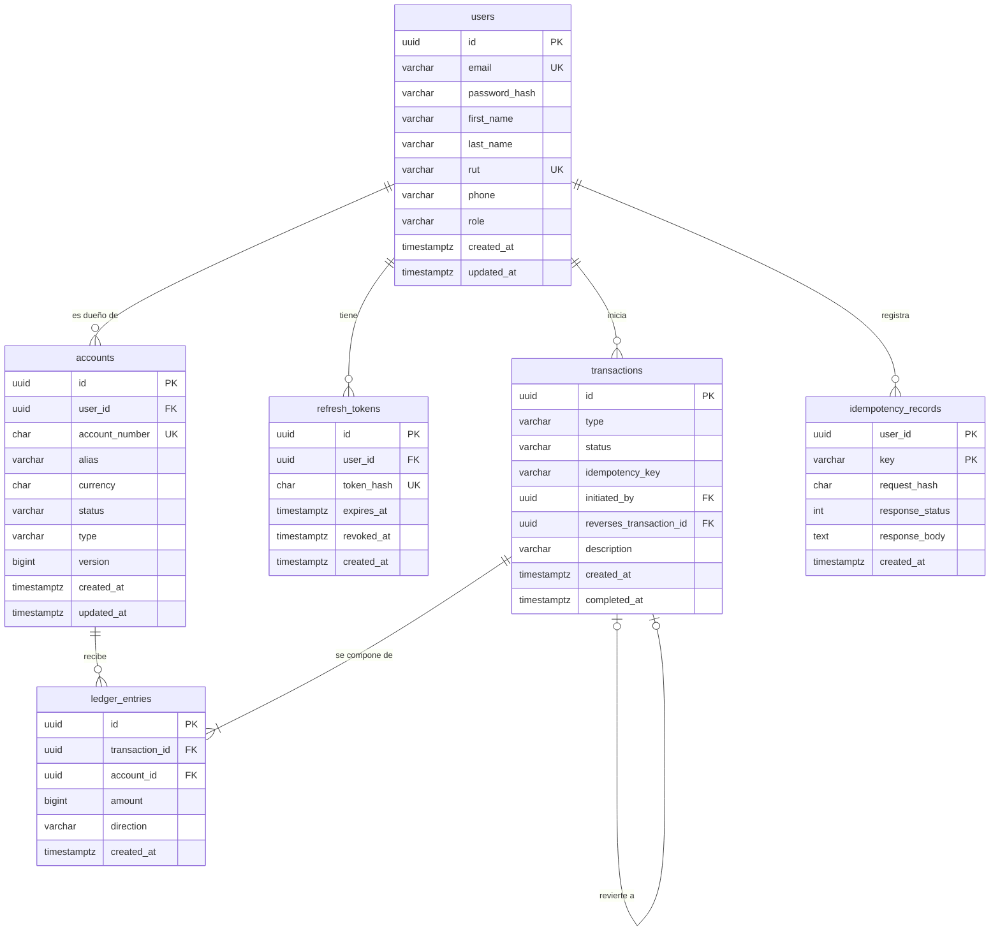

# Base de datos

Este documento describe el esquema de PostgreSQL de la Wallet API: qué guarda cada tabla, cómo se
relacionan, qué reglas impone la propia base de datos y cómo se registra un movimiento de dinero.

## Contenido

- [Visión general](#visión-general)
- [Diagrama entidad-relación](#diagrama-entidad-relación)
- [Tablas](#tablas)
- [Cómo se registra el dinero](#cómo-se-registra-el-dinero)
- [Reglas que impone la base de datos](#reglas-que-impone-la-base-de-datos)
- [Índices](#índices)
- [Concurrencia](#concurrencia)
- [Migraciones](#migraciones)
- [Consultas útiles](#consultas-útiles)

## Visión general

El esquema tiene seis tablas, agrupadas en tres áreas:

| Área | Tablas | Responsabilidad |
|---|---|---|
| Identidad | `users`, `refresh_tokens` | Clientes, administradores y sus sesiones |
| Libro contable | `accounts`, `transactions`, `ledger_entries` | Cuentas y movimientos de dinero en doble entrada |
| Soporte | `idempotency_records` | Respuestas guardadas para que una petición repetida no se ejecute dos veces |

Tres principios guían el diseño:

1. **El saldo no se guarda: se calcula.** Ninguna tabla tiene una columna de saldo. El saldo de
   una cuenta es la suma de sus créditos menos la suma de sus débitos en `ledger_entries`. Así el
   historial es la única fuente de verdad y no existe un dato que pueda quedar desincronizado.
2. **El libro es inmutable.** Un asiento nunca se modifica ni se borra. Para corregir un
   movimiento se registra otro, inverso (una reversa).
3. **La base de datos no confía ciegamente en la aplicación.** Las reglas contables críticas se
   validan en Java y además en PostgreSQL, con restricciones y triggers. Un error en el código no
   puede dejar el libro descuadrado.

Todas las claves primarias son UUID versión 7, que se generan ordenados por tiempo y mantienen
compactos los índices. Las fechas se guardan como `timestamptz` en UTC.

## Diagrama entidad-relación



Cómo leer las relaciones:

- Un usuario puede tener varias cuentas, sesiones, transacciones iniciadas y registros de
  idempotencia. La cuenta interna del sistema no tiene dueño.
- Una transacción se compone de al menos dos asientos, y cada asiento pertenece a una cuenta.
- Una transacción de tipo `REVERSAL` apunta a la transacción que revierte, y cada transacción puede
  ser revertida a lo más una vez.

## Tablas

### `users`

Clientes y administradores.

| Columna | Tipo | Nulo | Descripción |
|---|---|---|---|
| `id` | `uuid` | No | Identificador |
| `email` | `varchar(254)` | No | Correo en minúsculas; único |
| `password_hash` | `varchar(100)` | No | Contraseña hasheada con BCrypt; la contraseña nunca se guarda |
| `first_name`, `last_name` | `varchar(60)` | No | Nombre y apellidos |
| `rut` | `varchar(10)` | Sí | RUT normalizado (`12345678-5`); único. Obligatorio para clientes |
| `phone` | `varchar(12)` | Sí | Celular en formato `+569XXXXXXXX` |
| `role` | `varchar(10)` | No | `USER` (cliente) o `ADMIN` |
| `created_at`, `updated_at` | `timestamptz` | No | Creación y última modificación |

Los administradores son personal interno y no necesitan RUT; por eso la columna admite nulos y
una restricción exige el RUT solo cuando el rol es `USER`.

### `refresh_tokens`

Sesiones activas. Cada inicio de sesión crea una fila; cada renovación revoca la anterior y crea
una nueva.

| Columna | Tipo | Nulo | Descripción |
|---|---|---|---|
| `id` | `uuid` | No | Identificador |
| `user_id` | `uuid` | No | Dueño de la sesión |
| `token_hash` | `char(64)` | No | SHA-256 del refresh token; único. El token en claro nunca se guarda |
| `expires_at` | `timestamptz` | No | Vencimiento (siete días después de emitido) |
| `revoked_at` | `timestamptz` | Sí | Momento en que se revocó, por renovación o cierre de sesión |
| `created_at` | `timestamptz` | No | Emisión |

Guardar solo el hash impide que alguien con acceso a una copia de la base pueda usar los tokens.
Si se presenta un token ya revocado, se asume que fue robado y se revocan todas las sesiones del
usuario.

### `accounts`

Cuentas de la billetera. No tienen columna de saldo.

| Columna | Tipo | Nulo | Descripción |
|---|---|---|---|
| `id` | `uuid` | No | Identificador |
| `user_id` | `uuid` | Sí | Dueño; nulo solo en la cuenta del sistema |
| `account_number` | `char(10)` | No | Número de cuenta: nueve dígitos aleatorios y un dígito verificador (Luhn); único |
| `alias` | `varchar(40)` | Sí | Nombre que le da el cliente ("Ahorro", "Gastos") |
| `currency` | `char(3)` | No | Moneda; por ahora solo `CLP` |
| `status` | `varchar(10)` | No | `ACTIVE` o `BLOCKED` |
| `type` | `varchar(10)` | No | `USER` (cuenta de cliente) o `SYSTEM` (cuenta interna) |
| `version` | `bigint` | No | Versión para bloqueo optimista (ver [Concurrencia](#concurrencia)) |
| `created_at`, `updated_at` | `timestamptz` | No | Creación y última modificación |

**La cuenta del sistema.** La migración inicial crea una cuenta especial de tipo `SYSTEM`, con id
`00000000-0000-0000-0000-000000000001` y número `0000000000`. Representa el mundo exterior: es la
contraparte de todo depósito y retiro, de modo que el dinero que entra o sale de la billetera
también queda en doble entrada. Su saldo es negativo por diseño: equivale, con signo contrario, al
total de dinero que hay dentro de la billetera.

### `transactions`

Cada operación de dinero: un depósito, un retiro, una transferencia o una reversa.

| Columna | Tipo | Nulo | Descripción |
|---|---|---|---|
| `id` | `uuid` | No | Identificador |
| `type` | `varchar(12)` | No | `DEPOSIT`, `WITHDRAWAL`, `TRANSFER` o `REVERSAL` |
| `status` | `varchar(10)` | No | `COMPLETED` o `REVERSED` (`PENDING` y `FAILED` están reservados para operaciones asíncronas) |
| `idempotency_key` | `varchar(100)` | Sí | Clave enviada por el cliente; nula solo en reversas |
| `initiated_by` | `uuid` | No | Usuario que la ejecutó (cliente, o administrador en las reversas) |
| `reverses_transaction_id` | `uuid` | Sí | En una reversa, la transacción revertida |
| `description` | `varchar(140)` | Sí | Glosa ingresada por el cliente ("Pago arriendo") |
| `created_at` | `timestamptz` | No | Registro |
| `completed_at` | `timestamptz` | Sí | Término; obligatorio si está `COMPLETED` o `REVERSED` |

### `ledger_entries`

Los asientos contables: el movimiento de dinero sobre una cuenta. Es la tabla donde realmente
vive el dinero.

| Columna | Tipo | Nulo | Descripción |
|---|---|---|---|
| `id` | `uuid` | No | Identificador |
| `transaction_id` | `uuid` | No | Transacción a la que pertenece |
| `account_id` | `uuid` | No | Cuenta afectada |
| `amount` | `bigint` | No | Monto en pesos enteros; siempre mayor que cero |
| `direction` | `varchar(6)` | No | `CREDIT` (aumenta el saldo) o `DEBIT` (lo disminuye) |
| `created_at` | `timestamptz` | No | Mismo instante que su transacción |

El monto es siempre positivo y el sentido lo da `direction`. Los montos son `bigint` porque el
peso chileno no usa decimales; nunca se usan tipos de punto flotante para dinero.

### `idempotency_records`

Respuestas guardadas de las operaciones que mueven dinero.

| Columna | Tipo | Nulo | Descripción |
|---|---|---|---|
| `user_id` | `uuid` | No | Usuario que envió la petición |
| `key` | `varchar(100)` | No | Valor del header `Idempotency-Key` |
| `request_hash` | `char(64)` | No | SHA-256 de la ruta y el cuerpo de la petición original |
| `response_status` | `int` | No | Código HTTP de la respuesta |
| `response_body` | `text` | No | Cuerpo JSON de la respuesta |
| `created_at` | `timestamptz` | No | Registro |

La clave primaria es compuesta, `(user_id, key)`: la misma clave puede usarla cada usuario por
separado. Si llega una petición con una clave ya registrada y el mismo `request_hash`, se devuelve
`response_body` sin ejecutar nada; si el hash es distinto, se rechaza.

## Cómo se registra el dinero

Cada operación crea una fila en `transactions` y dos asientos en `ledger_entries`, uno de débito y
otro de crédito por el mismo monto. Los ejemplos siguen a una clienta, Camila, con dos cuentas: A
y B.

**Depósito de $100.000 en la cuenta A.** El dinero entra desde el exterior, representado por la
cuenta del sistema:

| Cuenta | Dirección | Monto |
|---|---|---|
| Sistema | `DEBIT` | 100.000 |
| A | `CREDIT` | 100.000 |

**Transferencia de $30.000 desde A hacia la cuenta de otro cliente, C:**

| Cuenta | Dirección | Monto |
|---|---|---|
| A | `DEBIT` | 30.000 |
| C | `CREDIT` | 30.000 |

**Retiro de $20.000 desde A.** El dinero sale hacia el exterior:

| Cuenta | Dirección | Monto |
|---|---|---|
| A | `DEBIT` | 20.000 |
| Sistema | `CREDIT` | 20.000 |

**Reversa de la transferencia.** Un administrador la revierte: se crea una transacción nueva de
tipo `REVERSAL`, con los mismos asientos en sentido contrario, y la transferencia original pasa a
estado `REVERSED`. Ninguna fila anterior se modifica ni se borra:

| Cuenta | Dirección | Monto |
|---|---|---|
| A | `CREDIT` | 30.000 |
| C | `DEBIT` | 30.000 |

Después de estas operaciones, el saldo de A es 100.000 − 30.000 − 20.000 + 30.000 = 80.000. En
cada transacción los débitos suman lo mismo que los créditos, por lo que la suma de todos los
asientos del libro es siempre cero: el dinero no se crea ni se destruye, solo se mueve entre
cuentas.

## Reglas que impone la base de datos

### Restricciones de valores (`CHECK`)

| Restricción | Regla |
|---|---|
| `ck_users_role` | El rol es `USER` o `ADMIN` |
| `ck_users_rut_format` | El RUT tiene el formato `12345678-5` (sin puntos, dígito verificador en mayúscula) |
| `ck_users_rut_required` | Todo cliente (`USER`) tiene RUT |
| `ck_users_phone_format` | El celular tiene el formato `+569XXXXXXXX` |
| `ck_accounts_currency` | La moneda es `CLP` |
| `ck_accounts_status` | El estado es `ACTIVE` o `BLOCKED` |
| `ck_accounts_type` | El tipo es `USER` o `SYSTEM` |
| `ck_accounts_owner` | Las cuentas `USER` tienen dueño y la cuenta `SYSTEM` no |
| `ck_accounts_number_format` | El número de cuenta tiene diez dígitos |
| `ck_transactions_type` | El tipo es uno de los cuatro válidos |
| `ck_transactions_status` | El estado es uno de los cuatro válidos |
| `ck_transactions_reversal` | Solo las reversas apuntan a otra transacción, y siempre lo hacen |
| `ck_transactions_idempotency` | Toda transacción que no es reversa tiene clave de idempotencia |
| `ck_transactions_completed_at` | Una transacción completada o revertida tiene fecha de término |
| `ck_ledger_entries_amount` | El monto de un asiento es mayor que cero |
| `ck_ledger_entries_direction` | La dirección es `DEBIT` o `CREDIT` |

### Unicidad

| Restricción | Columnas | Para qué |
|---|---|---|
| `uq_users_email` | `email` | Un correo por usuario |
| `uq_users_rut` | `rut` | Un RUT por usuario |
| `uq_refresh_tokens_hash` | `token_hash` | Cada token identifica una sola sesión |
| `uq_accounts_number` | `account_number` | Cada número de cuenta es único |
| `uq_transactions_idempotency` | `initiated_by`, `idempotency_key` | Un usuario no puede registrar dos operaciones con la misma clave |
| `uq_transactions_reverses` | `reverses_transaction_id` | Una transacción se revierte a lo más una vez |

### Triggers

| Trigger | Tabla | Momento | Qué hace |
|---|---|---|---|
| `tg_ledger_entries_immutable` | `ledger_entries` | Antes de `UPDATE` o `DELETE` | Rechaza cualquier cambio o borrado de un asiento |
| `tg_transactions_immutable` | `transactions` | Antes de `UPDATE` o `DELETE` | Rechaza el borrado y cualquier cambio salvo el estado (y fijar una vez la fecha de término) |
| `tg_ledger_entries_balanced` | `ledger_entries` | Al confirmar la transacción (diferido) | Verifica que cada transacción tenga al menos dos asientos y que sus débitos igualen a sus créditos |

El último es un trigger diferido (`DEFERRABLE INITIALLY DEFERRED`): no se evalúa después de cada
`INSERT`, cuando la transacción todavía está a medio registrar, sino al hacer `COMMIT`, cuando ya
están todos sus asientos. Si no cuadra, la transacción completa se deshace.

Estas reglas existen también en el código Java. Que la base las repita es defensa en
profundidad: aunque un error en la aplicación intentara modificar un asiento o registrar una
transacción descuadrada, la base de datos lo rechazaría.

## Índices

| Índice | Columnas | Consulta que acelera |
|---|---|---|
| `ix_ledger_entries_account_created` | `account_id`, `created_at` | Saldo de una cuenta e historial filtrado por fecha |
| `ix_ledger_entries_transaction` | `transaction_id` | Asientos de una transacción (reversas, conciliación) |
| `ix_transactions_initiated_by_created` | `initiated_by`, `created_at` | Operaciones de un usuario por fecha |
| `ix_accounts_user` | `user_id` | Cuentas de un cliente |
| `ix_refresh_tokens_user` | `user_id` | Revocar todas las sesiones de un usuario |

Además, cada restricción de unicidad crea su propio índice, y las claves primarias también.

## Concurrencia

La base de datos participa en tres mecanismos que evitan errores cuando llegan muchas peticiones
al mismo tiempo:

- **Bloqueo pesimista de cuentas.** Antes de validar un saldo, la aplicación bloquea las filas
  de las cuentas involucradas con `SELECT ... FOR UPDATE`. Otra operación sobre las mismas cuentas
  espera hasta que la primera termine, de modo que dos retiros simultáneos no pueden aprobarse
  con el mismo saldo. En una transferencia, las dos cuentas se bloquean siempre en el mismo orden
  para evitar deadlocks. La cuenta del sistema nunca se bloquea: todas las operaciones pasan por
  ella y su saldo no se valida.
- **Bloqueo optimista con `version`.** Al modificar una cuenta (por ejemplo, cuando un
  administrador cambia su estado), PostgreSQL solo acepta el cambio si la versión no cambió desde
  que se leyó. Si dos administradores la modifican a la vez, el segundo recibe un error en lugar
  de pisar el cambio del primero.
- **Advisory locks para la idempotencia.** Dos peticiones simultáneas con la misma clave de
  idempotencia se ordenan con `pg_advisory_xact_lock` sobre el par usuario y clave. Es un bloqueo
  sobre un valor y no sobre una fila, por lo que funciona aunque la fila de `idempotency_records`
  todavía no exista.

## Migraciones

El esquema se crea y evoluciona con Flyway. Las migraciones están en
`src/main/resources/db/migration` y se aplican solas al arrancar la aplicación. Hibernate no
modifica el esquema: solo valida que las entidades coincidan con él (`ddl-auto: validate`).

| Versión | Contenido |
|---|---|
| `V1__initial_schema.sql` | Las seis tablas, la cuenta del sistema, las restricciones y los triggers del libro contable |
| `V2__profile_and_account_details.sql` | Datos de perfil del cliente (nombre, RUT, celular), número de cuenta y alias, glosa y fecha de término de las transacciones |

Una migración ya aplicada nunca se modifica: cualquier cambio va en una versión nueva. La V2
muestra cómo agregar una restricción a una tabla que ya tiene datos: la exigencia de RUT para los
clientes se agregó con `NOT VALID`, de modo que se aplica a todas las filas nuevas sin obligar a
corregir las existentes.

## Consultas útiles

Saldo de una cuenta:

```sql
SELECT COALESCE(SUM(CASE direction WHEN 'CREDIT' THEN amount ELSE -amount END), 0) AS saldo
FROM ledger_entries
WHERE account_id = :cuenta;
```

Verificar que el libro completo cuadra (debe devolver cero):

```sql
SELECT SUM(CASE direction WHEN 'CREDIT' THEN amount ELSE -amount END) AS diferencia
FROM ledger_entries;
```

Transacciones que no cuadran (debe devolver cero filas):

```sql
SELECT transaction_id
FROM ledger_entries
GROUP BY transaction_id
HAVING SUM(CASE direction WHEN 'CREDIT' THEN amount ELSE -amount END) <> 0;
```

Cuentas de clientes con saldo negativo (solo posibles tras una reversa):

```sql
SELECT a.account_number,
       SUM(CASE e.direction WHEN 'CREDIT' THEN e.amount ELSE -e.amount END) AS saldo
FROM accounts a
JOIN ledger_entries e ON e.account_id = a.id
WHERE a.type = 'USER'
GROUP BY a.account_number
HAVING SUM(CASE e.direction WHEN 'CREDIT' THEN e.amount ELSE -e.amount END) < 0;
```

Para conectarse a la base levantada con Docker Compose:

```bash
docker exec -it wallet-postgres psql -U wallet -d wallet
```
